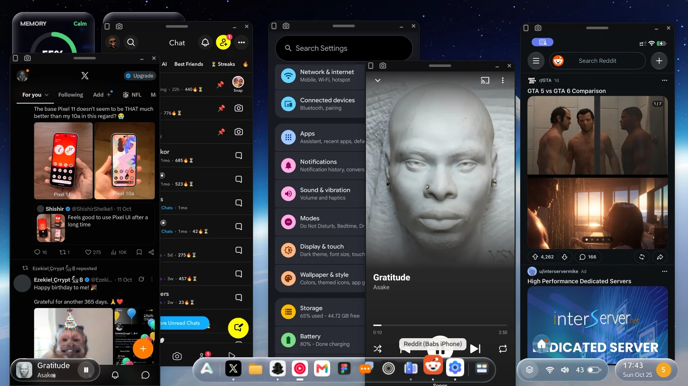

# Handset

Handset brings Android phones and iPhones onto the Linux desktop. Each phone's screen appears live
in a native GTK 4 and libadwaita window, controlled with the mouse, touchpad and keyboard, and the
phone joins the rest of the desktop: its apps in the launcher and dock, and its notifications,
clipboard, files, sound and media. Nothing is installed on the phone. Handset works through adb on
Android, Apple's device services on the iPhone, and standard Bluetooth profiles.



**[Feature reference](FEATURES.md)**: every feature in detail, with the settings, shortcuts,
command line, requirements and known limitations.

## Installing

On Ubuntu or Debian, Fedora, Arch (or EndeavourOS, Manjaro) and openSUSE, one command installs
Handset and everything it needs:

```sh
curl -fsSL https://raw.githubusercontent.com/Officialbabs/handset/master/install.sh | sh
```

It asks before it installs any packages (through sudo), fetches Handset into
`~/.local/share/handset/source`, and sets it up for you. Run it again to update Handset. To see
what it would do first, changing nothing, add `-s -- --check` after `sh`.

From a copy of Handset (`git clone https://github.com/Officialbabs/handset.git`), run the same
script in its folder:

```sh
./install.sh             # everything: it asks before installing packages or Rust
./install.sh --check     # what's missing, changing nothing
./install.sh --uninstall
```

In order, it:

1. **Installs the distribution's packages Handset uses**, the missing ones only, at once through
   sudo: Python with PyGObject and pycairo, GTK 4 and libadwaita, GStreamer (with libav, and the
   VA-API plugin and the graphics card's video driver, so the GPU decodes the phones' video),
   adb and its USB rules, usbmuxd, Avahi, fuse3, wl-clipboard, pactl, BlueZ, git and curl.
   Bluetooth and Avahi are switched on where they're off.
2. **Checks GTK and libadwaita** are new enough: GTK 4.16 and libadwaita 1.6, so Ubuntu 24.10 or
   later, Debian 13, Fedora 41 or later, Arch, openSUSE Tumbleweed or Leap 16. Then that the
   phones' video can be decoded here (H.264 for Android, HEVC for iPhones).
3. **Fetches scrcpy's server** 3.3.4, which Handset is made for (Android video, apps in their own
   windows, sound), from the scrcpy project, kept only if its checksum is the one the project
   publishes; a scrcpy package's copy is used instead when it's the very same file.
4. **Gets the iPhone helper.** On x86_64 it's ready-built: fetched from Handset's GitHub release
   and kept only if its checksum is the one pinned in `ios/prebuilt`, for this very helper source
   (and a C library at least glibc 2.34). Anywhere else, or once the helper's source has changed,
   it's built here with Rust 1.85 or newer: the distribution's, or rustup's (in `~/.cargo`), each
   asked first.
5. **Installs Handset for you:** the `handset` command, the menu entry, the phones' files in the
   desktop's search, and the sync, from sign-in.

`--yes` answers yes to its questions, `--no-deps` skips the packages (for when you see to them),
and `--deps-only` installs only them. Fedora and openSUSE leave H.264 and HEVC (the phones' video)
out of their own packages: where nothing here decodes them, the script offers to add RPM Fusion's
or Packman's, as each one's documentation says (asking first: it's another repository).

## Development and test platform

Handset is developed and tested on **Ada 26.04** (Ubuntu 26.04 base, Wayland session). On Ada it
works with the system's own phone features:
- Phones set up in Settings › Phones are ready in Handset with no further pairing.
- Ada's activity on a phone is shown in that phone's window.
- Handset has a switch in Control Center.

On other desktops, Handset finds and sets up phones itself (see [Adding a phone](#adding-a-phone)).

| Component | Tested version |
|---|---|
| Desktop | Ada 26.04, Wayland |
| GTK / libadwaita | 4.22 / 1.9 |
| GStreamer | 1.28 |
| scrcpy server | 3.3.4 |
| Android | 17 |
| iOS | 27 |

The installer supports other distributions (see [Installing](#installing)), but other desktops,
Android and iOS versions, and graphics hardware haven't been tested yet. The
[feature reference](FEATURES.md#18-test-platform) lists the full test configuration.

## Phones and settings

Launching Handset opens **Phones and Settings**. It also opens from the bezel's menu, with Ctrl+,
or with `handset --phones`. It shows:

- **A card for each known phone:** how it's connected, its battery, a Bluetooth mark when it's
  connected that way, a **Connected** switch and a **Show** button.
- **Handset's settings:** notifications, one thing playing at a time, opened apps in their own
  windows, and starting at sign-in.
- **What the computer provides for the phones:** adb, scrcpy's server, usbmuxd, the iPhone
  helper, hardware video decoding and Bluetooth.

Clicking a phone's card opens its page:

- **Connected:** when it's off, Handset leaves the phone alone (no window, notifications, clipboard
  or sound) until it's turned back on.
- **Over Wi-Fi:** when it's off, the phone is used by cable only.
- **Details:** the battery, the Android or iOS version, when it was last connected, and its
  Bluetooth link.
- **Actions:** Show, the phone's apps, Play Sound Here, iPhone Bluetooth pairing, and Forget.

**Each phone is also an app of its own.** It's listed under the phone's name in search and the app
menu, with a plain phone or Android robot icon. Its window has its own dock icon, so it can be
pinned and opened on its own.

### Adding a phone

On Ada, phones come from the system's phone service. On other desktops, Handset finds phones
itself: Android phones through adb (by cable or Wi-Fi) and iPhones through usbmuxd. Known phones
are kept in `~/.config/handset/phones.json`, so they stay listed while they're away. The **+**
button in Phones and Settings adds one:

- **An Android phone by cable:** turn on Developer options and USB debugging, then allow the
  computer on the phone. A phone adb can't open ("no permissions") needs the Android udev rules.
- **An Android phone over Wi-Fi**, in either of two ways:
  - **Use Over Wi-Fi Too** on the phone's page while it's plugged in. adb stays on Wi-Fi until the
    phone restarts, and Handset reconnects when it's back. It finds the phone's Wi-Fi on whichever
    interface it uses (a Pixel 7 on Android 17 has it on `wlan1`). On Ada it's offered for a phone
    the system's phone service has no Wi-Fi for.
  - **Wireless debugging's pairing code** (Android 11 and later). Handset finds the phone on the
    network through Avahi, and reconnects whenever it's back on the Wi-Fi.
- **An iPhone by cable**, one step at a time, each saying what to do on the phone:
  1. Trust this computer.
  2. Turn on Developer Mode. The phone restarts.
  3. Install Apple's developer disk image, which holds the touch input service. Handset fetches
     Xcode's image once (about 17 MB, from a public copy on GitHub), checks it, and has Apple's
     server sign it for the phone. Restarting the phone removes it, and Handset puts it back when
     the phone next connects.
  4. Optionally, pair for Wi-Fi. The pairing is kept in `~/.config/handset/pairings`. Without it,
     the iPhone works by cable.

## Using the phone window

The window shows the phone's screen edge to edge under a slim bezel, with no title bar or buttons.
Drag the bezel to move the window, or double-click it to fill the screen.

- **Mouse:** the pointer works as a finger. Press, drag and release as on the glass, and hold for a
  long press. The scroll wheel scrolls as a finger would: held on the phone, moved a step per
  notch, and lifted once the wheel stops.
- **Pinch:** pinch on the touchpad, or hold Ctrl and use the scroll wheel, to zoom with two fingers
  on the phone.
- **Other buttons:** right-click goes back, middle-click goes home, and dragging with the middle
  button moves the window. Resizing from the edges keeps the phone's shape.
- **Keyboard:** typing goes to the phone. Enter, Backspace, Tab, the arrow keys, Home and End work
  as they do on the phone, and Escape goes back. Android accepts plain letters, digits and
  punctuation only.
- **Shortcuts:** Ctrl+B back, Ctrl+H home, Ctrl+R recent apps, Ctrl+N notifications, F11 full
  screen, Ctrl+P next phone, Ctrl+Shift+A the phone's apps, Ctrl+W close.
- **Screenshots:** the camera button on the bezel, Ctrl+Shift+S or Print saves the phone's screen
  at its native resolution to Pictures › Screenshots and copies it to the clipboard. The capture is
  taken on the phone itself; an app's window captures that app's screen. Minimize and Close are on
  the right of the bezel.
- **Phone screen off (Android):** the brightness button on the bezel, Phone Screen Off in its menu,
  or Ctrl+Shift+O turns the phone's own screen off while its window keeps showing and working it.
  The phone stays awake meanwhile (its screen-off time is a day for the while, and put back after).
  The screen comes back on when you switch it off again, close the phone's last window, press the
  phone's power button, or the phone disconnects, and when Handset quits; scrcpy's server turns it
  back on even if Handset is stopped. The phone must be unlocked: once it locks, apps show black.
  An iPhone can't do this: it shares its screen only while it's lit.
- **Editing keys go to the phone** in any app:
  - Ctrl+A select all
  - Ctrl+C copy, which also puts the copy on the computer's clipboard
  - Ctrl+X cut
  - Ctrl+V paste: the computer's clipboard (text or an image) is sent to the phone first
  - Ctrl+Z undo, and Ctrl+Y or Ctrl+Shift+Z redo

  On an iPhone these become its keyboard's Command shortcuts.
- **Ada's activity (on Ada):** while Ada works on the phone, a small badge at the top says what
  Ada is doing and a ring goes round the screen. Ada waits while the phone is in use. Touches from
  the window are designed to count for this as a finger's do, but that hasn't yet been checked on
  a real phone.
- **More than one phone:** each phone has a window of its own. Ctrl+Shift+N (or New Window on
  Handset's icon) opens one for a phone no window shows yet, and Ctrl+P switches a window between
  phones, as does picking one on the page shown while one isn't connected.
  `handset --phone "‹phone name›"` opens a particular phone's window. Each window reopens at the
  size you gave it last time; app windows share one size, the last one you gave any of them (at
  first, nine tenths of the screen's height).

## The phone's apps on the desktop

While a phone is connected, every app in its app drawer appears in desktop search and among the
computer's apps, with its own icon and a name such as "WhatsApp (‹phone name›)".
- **Each app opens in its own window**, under its own dock icon (not Handset's), and can be pinned
  like any app.
- **When the phone disconnects,** its apps go with it, except pinned ones. Opening a pinned app
  then waits for the phone.
- **A small background service keeps the list up to date** (`handset --sync`, started at sign-in
  and by Handset). It reads each icon once, keeps it in `~/.cache/handset/apps`, and reads it again
  only when the app updates.

**Phone Apps…** in the bezel's menu (or Ctrl+Shift+A) lists the phone's apps, to open or pin one.
An app's window has the phone button on the left of its bezel (it opens the whole phone), the close
button on the right, and a thin frame round it.

- **On Android**, each app gets a virtual screen of its own on the phone, as big as the phone's,
  showing only that app.
  - The phone's own screen carries on as it was, and an app that was open there moves over.
  - Closing the window closes the app.
  - The app's screen sleeps with the phone and stays dark while the phone is locked. The window
    wakes the phone and says when to unlock it.
  - This needs scrcpy's server, which `install.sh` fetches.
  - Apps that block screen sharing (banking, some video apps) show black, as they do when
    mirrored.
- **Apps opened by another app**, such as a link opening a video app or an attachment opening a
  file viewer, come out into a window of their own (or into the window that app already has).
  - The new window shows what was opened, not the app's start screen, and closes when the app
    does.
  - Content an app opens inside itself (a page in its own browser tab, the app chooser, a
    permission prompt) stays in the original window.
  - Handset follows the phone's window manager over adb to do this.
  - To turn it off, set `"pop_out_apps": false` in `~/.config/handset/settings.json`.
- **On an iPhone**, the phone has one screen, so the app opens in front on it and the window shows
  the phone with that app. Closing the window takes the iPhone back to its home screen (unless
  it's gone dark, which Home would light). So does minimizing it with its bezel's button, when the
  app was opened over the home screen; coming back to the window brings the app back. A locked iPhone doesn't open apps; unlock it first.
- **Icons** come from the phone. On Android they're read from each app's package and drawn the way
  the launcher draws them, with the app's first letter on a colour when an icon can't be read.
  iPhone icons come from the phone itself.
- **Launcher entries:** each app is a menu entry in `~/.local/share/applications`
  (`io.github.Officialbabs.Handset.App.…`). On Ada, a pin is a line in the dock's pins
  (`~/.config/os-ai/dock.ini`). Each entry runs `handset --phone ID --app APP`.
  `handset --forget-apps` removes them all, as `./install.sh --uninstall` does.

## Notifications

A connected phone's notifications appear as native desktop notifications, under the app's name and
icon.
- **Clicking one** opens that app in a window of its own.
- **Clearing one on the phone** removes it from the desktop too.
- **Only notifications that would sound or pop up on the phone are shown.** That leaves out ongoing
  ones (music, downloads), group summaries, silent ones, and ones Do Not Disturb holds back.
- **Not yet supported:** replying from the desktop. Clearing one on the desktop leaves it on the
  phone.

How each phone sends them:

- **Android** sends them over adb as they're posted, from the phone's event log and
  `dumpsys notification`. Nothing is installed on the phone.
- **An iPhone** sends them over Bluetooth, the way it does to a watch (Apple Notification Center
  Service).
  - **Pair it once:** choose **Pair an iPhone for Notifications…** in the bezel's menu (or run
    `handset --pair-iphone`). Then, on the iPhone, open Settings › Bluetooth, pick this computer and
    allow its notifications.
  - **Discoverability:** the computer is discoverable for a few minutes while pairing. Afterwards
    it's discoverable only while that iPhone is out of reach, so the iPhone can reconnect by itself
    (Handset marks it trusted in BlueZ).
  - **Calls:** incoming calls have Accept and Decline on their notification.
  - **Only while connected:** notifications arrive only while the iPhone is also connected by cable
    or Wi-Fi. A minute after that connection ends, the computer releases the Bluetooth link, and
    the phone's media leaves the media controls. Handset takes the link up again when the phone is
    back.

To turn notifications off, use the Notifications switch in Phones and Settings, or set
`"phone_notifications": false` in `~/.config/handset/settings.json`.

## Clipboard and files

- **Shared clipboard.**
  - **Computer to phone:** copy on the computer, then click into a phone's window, and the copy is
    on the phone.
  - **Phone to computer:** the copy arrives at once if a Handset window is in front, otherwise as
    soon as one comes forward. The desktop lets only the window in front use the clipboard.
  - **Images to the phone:** an image goes onto the phone's clipboard only, never into its gallery
    or files, ready to paste in any app that accepts one. On Android, Handset's phone-side helper
    hands it to the pasting app from the Shell app's own files. On an iPhone it's placed on the
    clipboard as copied.
  - **Images from the phone:** images copied on an iPhone come to the computer too; from Android,
    only text does.
  - **Android's notice:** on Android, each time the computer reads the clipboard the phone shows
    its "pasted from your clipboard" notice, and setting text opens Android's clipboard editor.
    "Show clipboard access" in the phone's privacy settings turns the notice off.
- **Drop files on a phone's window** to send them. Existing files are never overwritten.
  - **Android:** files go to the phone's Download folder, where its apps see them straight away.
  - **iPhone:** photos and videos go to Photos, in an album named Handset. Audio goes to VLC (and
    its library), and other files go to the Files app, under On My iPhone › LocalSend (or Chrome).
- **Photos on an iPhone need a shortcut, made once**, because only a shortcut on the phone can add
  to its Photos library.
  1. In Photos, make an album named **Handset**.
  2. In Shortcuts, make a shortcut named **Handset Import** with two actions: Get Contents of
     Folder (On My iPhone › LocalSend › Handset) and Save to Photo Album (Handset).

  Handset then puts the photos in that folder and runs the shortcut (the iPhone must be unlocked).
  Once Photos has them, Handset removes them from the folder and returns the phone to the app it
  was in: that app, for an app's window; for the phone's window, the app Shortcuts came in front
  of (as reported through Apple's developer services), or the home screen. Without the shortcut,
  the photos wait in the folder and Handset shows how to make it.
- **Each phone is a folder** in `~/Phones` while it's connected. Any file manager, and any app's
  Open and Save dialogs, see its files as they'd see a USB stick's.
  - It's Handset's own file system (FUSE, talking directly to the kernel; nothing to install beyond
    fusermount3), over the phone's existing link, so it works the same by cable or Wi-Fi.
  - It shows an Android phone's storage, or an iPhone's media folders plus, under On My iPhone, the
    apps that share their files.
  - A file is fetched in full when it's opened, and kept for a day. A file written there is sent to
    the phone when it's closed.
  - **Open in Files** on a phone's page opens it. Phone Files in the File Manager turns it off.
- **Phone files in desktop search:** typing a file's name in the launcher shows matching files and
  folders from connected phones, under Handset, each with its phone and folder. Choosing one opens
  it in its default app, from the phone's folder.
  - Searches never wait on a phone: Handset keeps an index of each phone's file names, built when
    its folder appears and again every half hour. An Android phone's storage takes one `find`,
    under a second; an iPhone's is walked by the helper.
  - Hidden files and Android apps' private data are left out.
  - The background service answers through GNOME's search provider interface while it runs.
- **Phone Files…** (in the bezel's menu, or Ctrl+Shift+F) browses a phone's files. From there you
  can save a file to Downloads, open one with the computer's apps, or send files into the folder
  being viewed.
  - **Search** (Ctrl+F, or just type) filters the folder at once, then searches its subfolders.
  - An Android phone's storage is reached over adb. An iPhone's media folders (DCIM, recordings),
    and under On My iPhone the apps that share their files, are reached through Handset's helper
    (Apple's AFC and house arrest file services).

## Phone audio on the computer

**Play Sound Here** (in a phone window's bezel menu) plays the phone's audio on the computer
instead of the phone, until it's switched off. The choice is remembered and comes back with the
phone's window. If the audio can't come through at the moment (the phone is out of reach, say),
Handset keeps trying until it can.

- **Android** sends its audio over adb (scrcpy's server, Android 11 and later): music, video and
  games, while the phone itself goes quiet. Ringtones and notification sounds stay on the phone.
- **An iPhone** sends its audio over Bluetooth, with the computer acting as its headphones and
  hands-free device: all its sound, and calls when there is one (heard on the computer and
  answered through its microphone). Pair it with the computer once in Settings › Bluetooth on the
  iPhone, as for notifications.

## Media controls

Whatever a phone plays is one of the desktop's media players (MPRIS), so the desktop's media
controls show it (on Ada, the activity pill): title, artist and album, cover, position, and buttons
that control the phone.

**One thing playing at a time.** Playback is coordinated the way headphones switch between devices:
- A phone starting to play pauses the other phones and the computer's own players (a browser
  video, a music app).
- One of the computer's players starting pauses the phones.
- When it stops, whatever it paused plays again.
- A brief sound on the computer, such as a message tone, only lowers the phones' audio for a
  moment and pauses nothing. A phone starting to play never lowers its own sound.
- A track shorter than 20 seconds is a sound, never music: a web page's notification chime (two
  in a row, or one whose player keeps saying it plays) never pauses anything.
- The next track, or a moment of buffering, counts as the same playback going on.

To turn it off, set `"auto_pause": false` in `~/.config/handset/settings.json`.

- **Android** reports it through a small helper Handset runs on the phone over adb
  (`data/handset-media.jar`, built from `android/` by `android/build.sh`). It runs as adb's shell
  user, with nothing installed, and provides the app's own cover, the track's length and seeking.
  Without the helper, Handset reads the phone's media sessions as text (no cover, no seeking).
- **An iPhone** reports it over Bluetooth, the way it does to a car (Apple Media Service), without a
  cover. Handset looks the cover up in Apple's music catalog by artist and album (its public
  search, no account needed) and keeps it in `~/.cache/handset/covers`.

## With KDE Connect

Handset and KDE Connect do different jobs and run side by side.

- **Handset** is for using a phone from the computer: its screen, apps, sound and files. It works
  over the links the phone already has (adb, Apple's developer services, Bluetooth), with nothing
  installed on the phone.
- **KDE Connect** is for the phone and the computer working together, with its app on the phone.
  The phone can act as the computer's touchpad, presentation remote, or media and volume controls.
  It can also run commands on the computer, bring texts and contacts to it, and ring a lost phone.

A few things both apps do, so with both on they happen twice. Keep one of each:

- **Notifications:** Handset's Notifications switch (in Phones and Settings), or Notification sync
  in KDE Connect's app on the phone.
- **The clipboard:** either one shares it. KDE Connect's is its Clipboard plugin.
- **What the phone plays** shows twice in the desktop's media controls. KDE Connect's comes from its
  multimedia plugin.

## How it works

### Android

Handset uses adb by cable or over Wi-Fi, preferring the cable when both are available. On Ada it
shares the adb connection the system's phone service maintains.

- **Screen:** live H.264 video through scrcpy's server, which gives the smoothest picture and
  follows the phone as it turns. Handset sends the phone its own copy, the version it's made for
  (3.3.4, fetched by `install.sh` and checked against the scrcpy project's published checksum).
  Without it, Handset uses Android's own screen recorder. Frames go to GTK as they come from the
  decoder (YUV), and the GPU turns them into colour.
- **Touch:** through a virtual touchscreen Handset adds to the phone with Android's own `uinput`
  tool (nothing installed). The phone treats its touches as a finger's. Where a phone doesn't allow
  that, Handset falls back to sending each gesture whole.
- **Keys and text** go in as key presses.
- **Handset's own phone-side helper** (`data/handset-media.jar`) reads the phone's media sessions
  and sets images on its clipboard. It's 13 KB of Android bytecode (one `classes.dex`), built from
  `android/HandsetMedia.java` and `android/HandsetClip.java` by `android/build.sh` (javac, then
  Android's D8). It runs through `app_process` as adb's shell user while the phone is connected,
  and nothing is installed. It's kept in the repository so installing needs no Java. Rebuilding it
  with JDK 21.0.13 and D8 9.5.28 gives the very same file, SHA-256
  `b062fabcdad0ff6944ac50a1678cd94be886bee6acdff5ee37d170fd090742ea`.
- **Ada's activity** (on Ada) comes from the system's phone service, which Handset only listens to.

### iPhone

A small helper written in Rust (`ios/`, built by `install.sh`) talks to the phone through
`idevice`, the same toolkit Ada's phone service uses.

- **Connection:** the helper looks for the phone by cable and on Wi-Fi at the same time, and uses
  whichever answers first (the cable, when it's plugged in).
  - By cable, it goes through usbmuxd with the phone's own "Trust This Computer" pairing.
  - Over Wi-Fi, it uses Handset's Wi-Fi pairing, or on Ada the pairing the system already made.
  - Either way there's nothing to tap on the phone, and unplugging it carries on over Wi-Fi.
- **Screen:** Apple's own live screen-sharing stream (H.265, up to 60 frames a second, as Xcode
  shows it). The stream pads its frames out to whole blocks; Handset crops them to the screen's
  real size for each model.
- **Touches, buttons and typing** go in through Apple's developer input services, which take them
  while the screen is being streamed. An iPhone has no navigation buttons, so:
  - Back is a swipe in from the left edge.
  - Recent apps is Home pressed twice (the app switcher).
  - Notifications are a swipe down from the top.

  Typing follows a US keyboard's letters, digits and punctuation.
- **Ending cleanly:** the iPhone shares its screen like a call (the purple pill in its status bar).
  It keeps a stream nobody ended for up to an hour, holding its camera and microphone.
  - Handset ends its streams when its window closes.
  - The phone stops all its streams at once, so Handset does this only when they're all its own,
    never while Ada is sharing the screen.
  - Starting with no one else sharing the screen, Handset first ends streams left over from
    before.
  - A dark screen sends nothing, and its stream lights up with it, with no second stream started
    meanwhile.
- **Sharing the screen with Ada:** if Ada stops the screen stream (which stops them all), Handset
  starts its own again.

## Tests

```sh
python3 -m unittest discover -s tests -t .
```

The tests use a stand-in Android phone (`tests/fakeadb.py`), a stand-in iPhone helper
(`tests/fakeios.py`) and a stand-in phone service (`tests/fakeservice.py`); they never touch a
real phone or the real service.

## License

Handset is free software: you can redistribute it and/or modify it under the terms of the GNU
General Public License as published by the Free Software Foundation, either version 3 of the
License, or (at your option) any later version ([LICENSE](LICENSE)). It comes with no warranty.

- **scrcpy's server**, which `install.sh` fetches from the scrcpy project and Handset sends to
  Android phones, is Copyright © 2018 Genymobile and © 2018–2025 Romain Vimont, under the Apache
  License 2.0.
- **The Android robot** in Android phones' icons is reproduced or modified from work created and
  shared by Google and used according to terms described in the Creative Commons 3.0 Attribution
  License.
- Android is a trademark of Google LLC; iPhone is a trademark of Apple Inc. Handset isn't
  affiliated with or endorsed by either.
